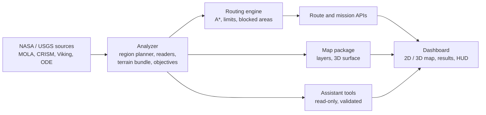

# MarsNav

**A layered, hyperlocal Marswalk planner built from real NASA data.**

MarsNav is for NASA Space Apps 2026 (the "Marswalk" challenge). Pick any area of Mars and MarsNav pulls real data from several NASA missions, layers it into one map, finds science sites worth visiting, and plans walking routes and science missions that fit inside a life-support budget (oxygen, time, reserve, return to base). An assistant answers questions about what the data shows, and only ever reports what its checked tools return.

It is a scientific **planning prototype**, not a certified EVA system. Walking pace, slope limits and reserves are stated assumptions, not NASA values, and the page says so wherever they matter.

## What it does

| Capability | Detail |
|---|---|
| **Layered map** | Zoomable, pannable Mars map. Optical imagery (Viking), terrain (MOLA elevation, slope, roughness, steep-terrain), and mineral evidence (CRISM) layered with independent visibility and opacity |
| **2D and 3D** | A solid 3D block of the real terrain with the imagery draped over it and hillshade lighting. If nothing has been analysed it reads the visible area by itself |
| **Region analysis** | Draw a box (up to about 45 km across). The analyzer reads only the rows it needs from public files, derives slope and roughness, and reports statistics with their limits |
| **Science objectives** | Hydrated minerals (CRISM spectral screen) plus two terrain-based objectives, flat safe sites and high vantage points. Every target shows its measured values, the rule that picked it, and its limits |
| **Honest "can't do that"** | For any other objective the app asks NASA's catalog (ODE) whether data covers the area. It reports what exists and that this tool cannot analyse it yet, and never claims absence if the catalog is unreachable |
| **Routes** | Deterministic A* on the analysed terrain: shortest, safest and balanced routes side by side, waypoints, a base point for the return trip, elevation profile, obstacles with replanning, and next-move guidance |
| **Science missions** | Picks the analysis' science targets with the best value per minute that fit the oxygen budget, plans every leg, and lists the targets it left out with the reason |
| **Assistant** | Docked chat panel with result cards and "show on map" actions. With a model configured it answers questions through read-only, validated tools; without one a rule-based assistant answers |
| **Safety limits** | Maximum slope, oxygen and duration budgets, reserve, return to base, unknown terrain excluded (never treated as safe), obstacles you mark |
| **Radiation** | A typical-exposure panel: published Curiosity RAD measurements (about 0.67 mSv per day at the surface) turned into the dose for your planned time outside, with its source and what it does not cover. A stored figure, not live data and not a forecast |
| **Data cap** | 64 MiB per analysis and 256 MiB per session, checked before anything is fetched |

## Data from NASA missions

| Layer | Source | Mission / instrument |
|---|---|---|
| Elevation, slope, roughness | USGS MOLA global DEM, 463 m, read by HTTP range request (the 2.1 GB file is never downloaded) | Mars Global Surveyor, MOLA |
| Optical imagery | Viking MDIM 2.1 colour mosaic, 232 m per pixel, via NASA Mars Trek tiles | Viking orbiters |
| Hydrated-mineral evidence | CRISM MTRDR summary-parameter cubes (three bands read by range request) from the PDS Geosciences Node | Mars Reconnaissance Orbiter, CRISM |
| Data discovery | ODE REST service (PDS Geosciences Node) for product footprints and availability | |

Details, verified URLs and what is *not* claimed are in [`docs/ANALYZER_STATUS.md`](docs/ANALYZER_STATUS.md) and [`docs/DATASET_SOURCES.md`](docs/DATASET_SOURCES.md).

## How it fits together



One FastAPI backend and one React + TypeScript frontend share typed contracts ([`docs/API_CONTRACTS.md`](docs/API_CONTRACTS.md), changes logged in [`docs/CONTRACT_CHANGELOG.md`](docs/CONTRACT_CHANGELOG.md)). Large arrays travel in a verified terrain bundle ([`docs/TERRAIN_CONTRACT.md`](docs/TERRAIN_CONTRACT.md)), never inside JSON.

## How the assistant stays honest

- It can only call **read-only tools** (analysis status and summary, science targets, data sources); arguments are validated before anything runs.
- It **cannot invent coordinates or analysis ids**: an id must come from the request or an earlier tool result.
- Numbers, map actions and warnings come from tool results, and answers show the limits that came with them.
- If the model is unavailable, slow, rate limited or returns malformed output, the **rule-based assistant answers** and the reply carries a warning saying why. The core planning never depends on a model.
- The model is **hosted** (Google's Generative Language API, a Gemma or Gemini model named in the panel header), so when it is enabled, analysis summaries and tool results are sent to Google and the chat needs internet.

## Known limits

- **Resolution.** MOLA is 463 m per cell. Boulders, small craters and other hazards below that size are invisible, and slope above a limit is not a safety assessment. Finer terrain (CTX, HiRISE) would plug into the same pipeline but is not built.
- **Safety data.** Radiation is a typical published value (one site, near solar maximum; solar storms are not modelled). There is no live Mars weather or space-weather feed and no thermal layer.
- **Spectral candidates are screens,** not identified minerals, and missing CRISM coverage is never evidence of absence.
- **Objectives.** Three are implemented. Everything else is answered with what NASA's catalog holds and an honest "not analysable yet".
- **Routes and plans are kept in memory**; after a backend restart plan again. Analyses are saved on disk and survive restarts.
- **Needs internet** to read NASA and USGS data and imagery tiles. There is no download service or cache yet.
- **Prototype assumptions:** walking pace 2 km/h, 30-minute reserve, a 20 percent distance reserve and the default slope limit are labelled assumptions.

## Quick start

Requirements: Python **3.11 or 3.12** (not 3.13 or newer) and Node.js 20 or newer. No database is needed for the current features.

```bash
# backend (Git Bash; on Windows create the venv with: py -3.12 -m venv .venv)
cd backend
python -m venv .venv
source .venv/Scripts/activate        # macOS/Linux: source .venv/bin/activate
pip install -e ".[dev]"
uvicorn app.main:app

# frontend (second terminal)
cd frontend
npm install
npm run dev
```

Open http://localhost:5173. The API documentation is at http://localhost:8000/docs.

### Configuration

Copy `.env.example` to `.env` at the repository root (it is git-ignored; never commit it).

| Variable | Default | Meaning |
|---|---|---|
| `GEMMA_MODEL`, `GEMMA_API_KEY` | empty | A Gemma or Gemini model id and API key. Leave both empty to keep the rule-based assistant |
| `GEMMA_API_BASE` | Google Generative Language API | Base URL of the model API |
| `ANALYZER_MAX_AREA_KM2` | 2500 | Largest analysis area |
| `ANALYZER_MAX_DOWNLOAD_BYTES` | 64 MiB | Most one analysis may read |
| `ANALYZER_SESSION_CAP_BYTES` | 256 MiB | Most all analyses may read since the backend started |
| `DATA_ROOT` | `../data` | Where analyses are saved (git-ignored) |
| `CORS_ORIGINS` | `http://localhost:5173` | Allowed browser origins |

### A short demo

1. **Analyze Region**: drag a box around the Jezero crater delta (about 20 km across) and press **Analyze Region**. You get real terrain, statistics and a CRISM candidate.
2. Switch to **3D**, then back to **2D** (your zoom is kept).
3. **Plan Route**: set a Start and a Destination anywhere (up to about 45 km apart) and press **Generate Routes**. The area around them is analysed first. Compare the routes, read the elevation profile, report an obstacle to replan.
4. **Plan Scientific Mission**: pick an objective, set the oxygen (about 8 hours for the Jezero sites; at walking pace 4 hours is often too little and the app says so) and press **Plan Mission**.
5. **Ask AI assistant**: "How steep is this area?", "Plan a science journey to find flat safe sites with 8 hours of oxygen", or ask for something not supported, such as boxwork formations, to see the honest catalog answer.

Analyses are saved under `data/derived/analyses/`, so repeating a request for the same area is instant.

## API quick reference

All under `/api/v1`. Full contracts are in [`docs/API_CONTRACTS.md`](docs/API_CONTRACTS.md) and the live OpenAPI at `/docs`.

| Area | Endpoints |
|---|---|
| Analysis | `POST /analyses`, `GET /analyses/{id}`, `GET /analyses/{id}/result`, `GET /analyses/{id}/map`, `GET /analyses/{id}/layers/{kind}.png`, `POST /analyses/{id}/cancel`, `GET /analyses/{id}/terrain.npz` |
| Objectives and data | `GET /objectives`, `POST /objectives/check`, `GET /data-budget` |
| Routing | `POST /routes`, `GET /routes/{id}`, `POST /routes/{id}/replan`, `POST /navigation/guide` |
| Missions | `POST /mission-plans`, `GET /mission-plans/{id}` |
| Assistant | `POST /assistant/messages`, `GET /assistant/status` |

## Repository layout

```
backend/    FastAPI app: app/analyzer (discovery, selection, preprocessing, science, publishing),
            app/connectors (ODE, USGS MOLA, PDS CRISM), app/routing (engine, API layer, mission planner),
            app/ai (assistant, hosted-model client, tools), app/api (routes), tests
frontend/   React + TypeScript dashboard: src/features (dashboard, mars-map), src/store, src/api, src/types
docs/       Specifications, contracts, status and member task documents
data/       Local data folders (contents are not committed)
```

## Tests

```bash
cd backend && python -m pytest -q                  # offline tests; RUN_REAL_DATA=1 also reads the live MOLA file
cd frontend && npm test && npx tsc --noEmit && npm run build
```

## Coordinates and units

Latitude is planetocentric degrees; longitude is east-positive in `[-180, 180)`; distances are metres, slopes degrees, durations minutes. Source products keep their original conventions and are converted at ingestion. See [`docs/COORDINATE_CONVENTIONS.md`](docs/COORDINATE_CONVENTIONS.md).

## Documentation

[`docs/PROJECT_SPEC.md`](docs/PROJECT_SPEC.md) · [`docs/SYSTEM_ARCHITECTURE.md`](docs/SYSTEM_ARCHITECTURE.md) · [`docs/ANALYZER_STATUS.md`](docs/ANALYZER_STATUS.md) · [`docs/SCIENCE_CRISM.md`](docs/SCIENCE_CRISM.md) · [`docs/ROUTING_SPEC.md`](docs/ROUTING_SPEC.md) · [`docs/BENCHMARKS.md`](docs/BENCHMARKS.md) · [`backend/README.md`](backend/README.md)

## Repository rules

One FastAPI app, one frontend, one source of truth for contracts. Keep downloaded products and generated rasters out of Git, and never commit `.env`. Branch names start with the member name and name the feature (for example `aakash/analyzer-terrain-pipeline`); open a PR into `main`; see [`CONTRIBUTING.md`](CONTRIBUTING.md).

## Credits

Data and imagery: NASA and USGS (MOLA, Viking MDIM via NASA Mars Trek, MRO CRISM and the PDS Geosciences Node, ODE). This project uses public data and is not affiliated with or endorsed by NASA.
