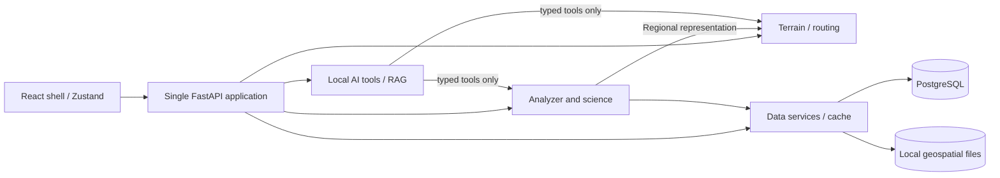
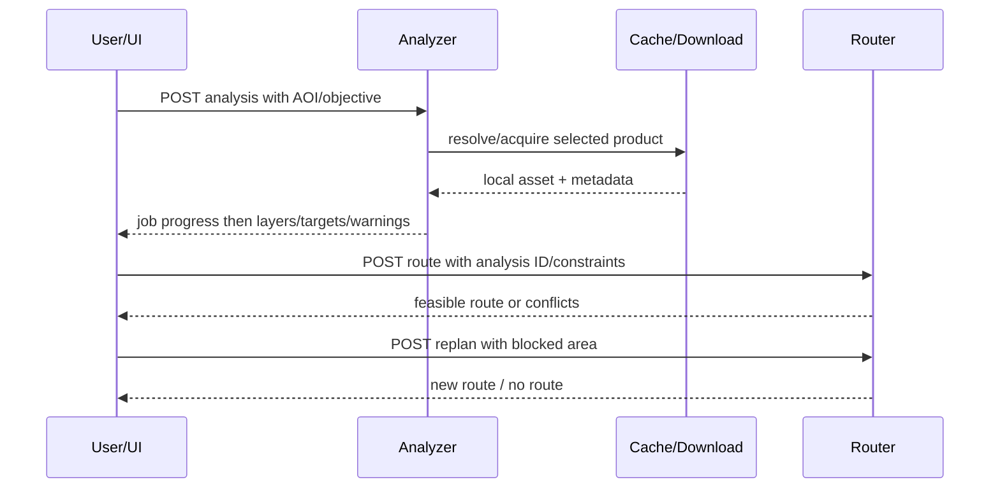

# System architecture

The frontend has one shell and one Zustand store. Dashboard owns controls/panels; map is an independently mounted feature consuming store state and typed API results. It renders but does not calculate science or routes.

FastAPI is one modular process. APIs are thin composition layers. Analyzer discovers/selects/validates/harmonizes products and publishes `RegionalAnalysisResult` layer references. Routing consumes only that representation plus route request; it has no connector/download dependency. Data services own files, cache metadata, freshness and mission persistence. AI invokes registered typed service adapters and answers only from their results plus retrieved local documents.

Dependency direction is UI → API → domain modules → adapters/storage. `schemas` has no dependency on modules. Analyzer may request acquisition through an interface; routing never imports analyzer implementation. All long work uses persisted analysis/download jobs; UI polls job resources until websocket work is explicitly justified.

Offline mode is an operational mode, not a separate app: frontend assets, API, database, cached files, processed layers and optional Ollama/index run locally. New discovery/refresh fails gracefully when offline; existing regional assets and routes remain usable.
